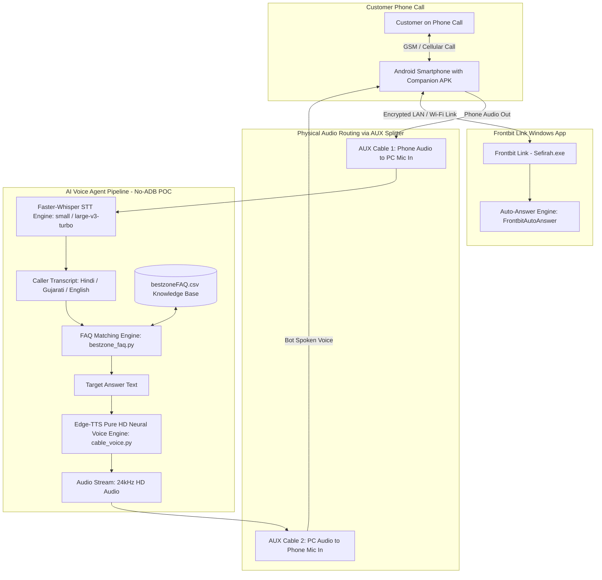

# FRONTBIT LINK & AI PHONE VOICE BOT - SYSTEM ARCHITECTURE

## 1. System Overview

Frontbit Link AI Voice Agent is an autonomous, on-premise telephonic customer service bot that connects a physical smartphone to a Windows PC, automatically answers incoming customer phone calls, transcribes caller speech in real time (Hindi, Gujarati, English), matches customer queries against an offline FAQ database (`bestzoneFAQ.csv`), and responds back to the caller in crystal-clear, 100% free High-Definition Neural Voice.



---

## 2. Component Breakdown

### A. Frontbit Link (`Sefirah.exe` & Companion APK)
- **Role**: Establishes phone-to-PC pairing over local Wi-Fi/LAN.
- **Companion APK**: `c:\Frontbit Link\Frontbit_Link_Android_Companion.apk` installed on the Android smartphone.
- **Auto-Answer Mechanism**: `phone_link_no_adb_bot.py` inspects the Windows UI tree for incoming call toast notifications and triggers call acceptance without requiring ADB USB debugging.

### B. Physical Audio Wiring
- **Caller Voice to PC**: Phone Headphone Jack (3.5mm) ➔ PC Microphone Line In (`Realtek(R) Audio`).
- **Bot Voice to Caller**: PC Speaker Out / Virtual Cable ➔ Phone Microphone In (via CTIA 4-pole Y-splitter).

### C. Speech-to-Text (STT) Engine
- **Engine**: `faster-whisper` (CTranslate2 backend).
- **Execution**:
  - NVIDIA GPU present: `mobiuslabsgmbh/faster-whisper-large-v3-turbo` with CUDA int8_float16.
  - CPU only: `Systran/faster-whisper-small` with CPU int8.
- **Language Detection**: Real-time multi-lingual detection (Hindi, Gujarati, English).

### D. FAQ & Knowledge Base Matching (`bestzone_faq.py`)
- **Database**: `bestzoneFAQ.csv`.
- **Matching Algorithm**: Token-based intent classification + `difflib.SequenceMatcher` token similarity.
- **Dynamic Variable Injection**: Handles pricing, order tracking, shipping policies, and business hours dynamically.

### E. Text-to-Speech (TTS) Voice Engine (`cable_voice.py`)
- **Engine**: Microsoft Azure Neural Voice (Edge-TTS Free 24kHz Endpoint - Zero API Key).
- **Voices**:
  - Hindi Female: `hi-IN-SwaraNeural` (Default, warm receptionist tone).
  - Hindi Male: `hi-IN-MadhurNeural` (Calm executive tone).
  - Gujarati Female: `gu-IN-DhwaniNeural` (Natural sweet Gujarati tone).
  - Gujarati Male: `gu-IN-NiranjanNeural` (Respectful Gujarati tone).
- **Acoustic Optimization**:
  - Conversational light punctuation parsing (replaces halting `।`, `!`, `?` with natural commas `,` to eliminate 1-second awkward robotic pauses).
  - Clean 8ms boundary anti-pop micro-fades.
  - Peak normalization to -0.7 dBFS (0.92) with zero distortion.

### F. Smart Auto-Installer & Launcher (`smart_launcher.ps1`)
- **Launcher**: `1 - START EVERYTHING (Frontbit Link + Voice Bot).cmd`.
- **First-time Run on New PC**:
  - Automatically checks Python installation. If missing, downloads Python 3.11 with a live visual GUI showing percentage (%), downloaded MB, and network speed (MB/s).
  - Creates virtual environment `VoiceAgent\venv`.
  - Installs requirements (`faster-whisper`, `edge-tts`, `bottle`, `scipy`, `soundfile`).
  - Verifies local neural models.
  - Automatically registers Windows Start Menu & Desktop shortcuts (`Frontbit Link.lnk`).
- **Subsequent Runs**: Skips all setup checks in 0.2s and directly launches `Sefirah.exe` + AI Voice Bot simultaneously!

---

## 3. Directory Map

```text
C:\Frontbit Link\
├── 1 - START EVERYTHING (Frontbit Link + Voice Bot).cmd  <-- MASTER 1-CLICK LAUNCHER
├── Setup_Voice_Agent.cmd                                <-- Standalone installer
├── Frontbit_Link_Android_Companion.apk                  <-- Mobile phone APK
├── HOW_TO_USE_VOICE_AGENT.txt                           <-- Gujarati user manual
├── Sefirah.exe                                          <-- Frontbit Link Desktop binary
├── Sefirah-trusted.msixbundle                           <-- Windows Store package
├── Logo.png                                             <-- Official application logo
└── VoiceAgent\
    ├── smart_launcher.ps1                               <-- GUI Installer & Auto-Launcher
    ├── AIPhoneVoiceBot\
    │   ├── cable_voice.py                               <-- Audio engine & TTS routing
    │   ├── requirements.txt                             <-- Python dependencies
    │   └── models\                                      <-- Faster-Whisper weights (2GB)
    └── AIPhoneVoiceBot_NoADB_POC\
        ├── phone_link_no_adb_bot.py                     <-- Core live bot orchestrator
        ├── bestzone_faq.py                              <-- FAQ matching algorithms
        ├── bestzoneFAQ.csv                              <-- Knowledge base database
        ├── voice_settings.json                          <-- Voice config (gender, speed, pitch)
        └── greeting.json                                <-- Call pickup welcome greeting
```
