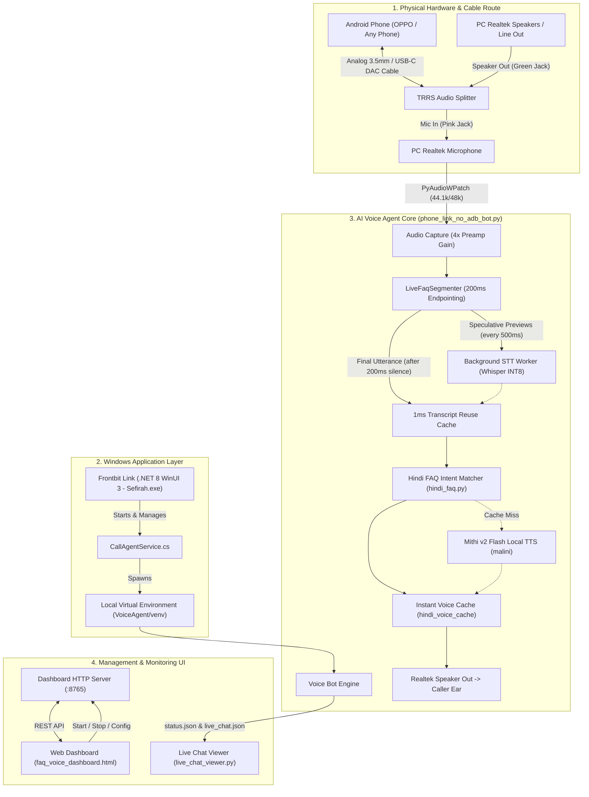

# Frontbit Link - Complete System Architecture & Client Deployment Guide
**LakshVoiceAgent: 100% Offline, Local Neural Hindi AI Phone Voice Bot**

---

## 1. Executive Summary

**Frontbit Link** is a self-contained, enterprise-grade Windows desktop communication platform bundled with **LakshVoiceAgent** — a 100% offline, local AI voice agent capable of handling live telephone calls in Hindi (and Gujarati/English) with human-like conversation latency (~200ms–350ms).

### Key Highlights
* **Zero Cloud Dependencies & Zero API Costs**: Runs entirely offline on local CPU hardware. No OpenAI, Google Cloud, or Azure billing required.
* **100% Wired Analog Audio Architecture**: Direct phone-to-PC audio routing via USB-C / 3.5mm analog interface. No Bluetooth latency, no call drops, no ADB driver requirement.
* **Local Fast Hindi STT**: Fine-tuned `vasista22/whisper-hindi-small` (INT8 quantized CTranslate2) running on 6 CPU threads with speculative preview streaming.
* **Local Neural Hindi TTS**: Mithi v2 Flash (`malini` female voice / `anirban` male voice) generating 24kHz studio-quality speech, resampled to 48kHz and pre-cached for instant (<1ms) replay.
* **Ultra-Low Latency Conversational Engine**: Speculative background decode decodes caller speech in parallel while the caller is still speaking. When speech stops, answers are dispatched in ~200ms.
* **Integrated Windows Ecosystem**: Native .NET 8 WinUI 3 interface (`Sefirah.exe`), web dashboard (`faq_voice_start_page.py`), and real-time call viewer (`live_chat_viewer.py`).

---

## 2. System Architecture Diagram



---

## 3. Directory Structure & File Map

Everything required to run the entire system is self-contained inside the root folder `C:\Frontbit Link\`:

```text
C:\Frontbit Link\
│
├── Sefirah.exe                               # Main Frontbit Link Windows Desktop App
├── Logo.png                                  # App icon & branding
│
├── models\                                   # Neural Models Directory
│   └── mithi-v2-flash\                       # Mithi v2 Flash Local Hindi TTS Model
│       ├── config.json                       # Architecture configuration
│       ├── decoder.safetensors               # Acoustic neural decoder (117 MB)
│       ├── writer.safetensors                # Text encoder weights (37 MB)
│       ├── voices.safetensors                # Voice embeddings (malini & anirban)
│       └── run.py                            # Native Mithi runtime script
│
├── VoiceAgent\                               # Voice Agent Subsystem
│   │
│   ├── smart_launcher.ps1                    # 1-Click launcher & dependency validator
│   │
│   ├── venv\                                 # 100% Self-Contained Python 3.12 Environment
│   │   ├── pyvenv.cfg                        # Environment config
│   │   ├── Scripts\                          # python.exe, pip.exe, pythonw.exe
│   │   └── Lib\site-packages\                # 14 installed libraries (faster_whisper, torch, etc.)
│   │
│   ├── AIPhoneVoiceBot\                      # Base Models & Knowledge Base
│   │   ├── models\                           # Whisper Speech Recognition Models
│   │   │   ├── hindi\EtMmohammedHafsati...   # Vasista22 Whisper Hindi Small INT8 (Active STT)
│   │   │   ├── models--mobiuslabsgmbh...     # Large-v3-Turbo Whisper Model
│   │   │   └── models--Systran...            # Small & Tiny Multilingual Whisper Models
│   │   └── requirements.txt                  # Dependency list
│   │
│   └── AIPhoneVoiceBot_NoADB_POC\            # Active No-ADB Production Engine
│       ├── phone_link_no_adb_bot.py          # Master Voice Agent Bot Script
│       ├── frontbit_link_bot.py              # CLI launcher entry point
│       ├── faq_voice_start_page.py           # Dashboard HTTP API Server (Port 8765)
│       ├── faq_voice_dashboard.html          # Web UI for FAQ management & bot control
│       ├── live_chat_viewer.py               # Real-time Call Transcript Window (PyWebView)
│       ├── live_chat_viewer.html             # Chat UI rendering live bubbles
│       ├── hindi_faq.py                      # 100 BestZone Hindi FAQs & phonetic matcher
│       ├── mithi_tts_engine.py               # Mithi v2 Flash TTS integration wrapper
│       ├── hindi_voice_cache\                # Pre-rendered 48kHz WAV audio files (<1ms reply)
│       ├── live_chat.json                    # Real-time conversation stream log
│       ├── status.json                       # Real-time bot telemetry (idle, speaking, RMS)
│       └── logs\                             # Daily call transcripts and diagnostic logs
│
└── src\                                      # C# Source Code (For compilation & modifications)
    └── Sefirah\
        └── Services\CallAgentService.cs      # Background service orchestrating the bot
```

---

## 4. Hardware Connection & Audio Routing

### Physical Cable Wiring
To achieve zero-latency and 100% offline phone call handling without Bluetooth or ADB:
1. **Phone Side**: Plug a 3.5mm Aux Cable (or USB-C to 3.5mm DAC dongle) into the mobile phone.
2. **Splitter**: Connect a standard **TRRS (4-pole) to dual TRS (3-pole) Audio Splitter**:
   - One lead is **Headphone/Audio Out** (sound from phone).
   - One lead is **Microphone/Audio In** (sound into phone).
3. **PC Side**:
   - Connect the Phone's Headphone line into the **PC Microphone In (Pink Jack)**.
   - Connect the Phone's Microphone line into the **PC Speaker/Line Out (Green Jack)**.

### Windows Audio Device Settings
* **Default Recording Device**: `Microphone (Realtek(R) Audio)`
* **Default Playback Device**: `Speakers (Realtek(R) Audio)`

---

## 5. Software Components Explained

### A. Speculative Streaming STT Engine (`phone_link_no_adb_bot.py`)
* **Model**: `vasista22/whisper-hindi-small` INT8 quantized via CTranslate2.
* **Turn-Taking Latency**:
  - `HINDI_ENDPOINT_FRAMES = 2`: 200 ms of silence ends the question.
  - While caller speaks, `LiveFaqSegmenter` emits periodic previews every 500ms.
  - Whisper transcribes the preview in parallel while the caller is talking.
  - When caller stops, `hindi_transcript()` checks the preview cache: if audio voiced frames match within 400ms, the transcript is reused in **0.001 seconds (1 millisecond)**.
  - Total time from caller finishing speech to bot speaking: **~200 ms**.
* **False Echo Guard**:
  - `is_bot_echo()` only evaluates if caller speech overlaps bot playback (`during_bot`).
  - Short conversational phrases ("क्या है", "नमस्ते", "हाँ") are protected and never falsely discarded.
* **Line Noise Filter**:
  - Gated at `peak < 0.08` and `rms < 0.012` to reject wire static while picking up quiet speech.

### B. Local Neural TTS Engine (`mithi_tts_engine.py`)
* **Model**: Mithi v2 Flash (Oomni/mithi-v2-flash).
* **Voice**: `malini` (female voice) / `anirban` (male voice).
* **Audio Format**: Synthesized at 24 kHz, automatically resampled to 48 kHz mono PCM, compatible with Realtek audio drivers.
* **Pre-Caching**: All 100 FAQs are pre-rendered into `hindi_voice_cache/`. During live calls, bot plays pre-cached WAVs with **0 ms generation delay**.

### C. Dashboard & Web Management (`faq_voice_start_page.py`)
* Serves a local REST API on port `8765`.
* Manages 100 product and service FAQs in `hindi_faq.py`.
* Allows 1-click Start/Stop of the voice bot, pickup delay configuration, and business hours scheduling.

---

## 6. How to Deploy on a New Client PC

When delivering `C:\Frontbit Link` to a client PC:

### Step 1: Copy the Folder
Copy the entire `Frontbit Link` folder to the client's PC (recommended path: `C:\Frontbit Link`).

### Step 2: Prerequisites on Client PC
1. **Operating System**: Windows 10 or Windows 11 (64-bit).
2. **Audio Drivers**: Realtek High Definition Audio Driver.
3. **Base Python** (if running outside venv): Python 3.12 (64-bit) installed to default location `C:\Program Files\Python312`.
*(Note: `Frontbit Link\VoiceAgent\venv` is already pre-configured and portable).*

### Step 3: Run the Smart Launcher
In PowerShell (Administrator or standard user):
```powershell
Set-ExecutionPolicy -Scope Process -ExecutionPolicy Bypass
& "C:\Frontbit Link\VoiceAgent\smart_launcher.ps1"
```
The launcher will:
1. Verify all 14 Python modules in `VoiceAgent\venv`.
2. Verify all models (`vasista22` STT and `mithi-v2-flash` TTS).
3. Create Desktop and Start Menu shortcuts.
4. Launch `Sefirah.exe` and start the Voice Agent.

### Step 4: Run Direct from Frontbit Link App
Double-click `C:\Frontbit Link\Sefirah.exe`:
1. Navigate to the **Call Agent** tab.
2. Click **Start Voice Bot**.
3. Click **Live Chat** to view the live transcript screen.

---

## 7. Master AI Prompt for Client PC Setup
*(Copy and paste this prompt to any AI assistant on a new PC to immediately manage, inspect, or troubleshoot the bot)*

```markdown
You are an expert AI engineer working on the LakshVoiceAgent / Frontbit Link system located at:
`C:\Frontbit Link`

### Architecture Summary:
1. **Self-Contained Workspace**:
   - Everything is in `C:\Frontbit Link`. No external dependencies or paths like `C:\agentvoice` are needed.
   - Virtual Environment: `C:\Frontbit Link\VoiceAgent\venv\Scripts\python.exe`
   - Active Bot Directory: `C:\Frontbit Link\VoiceAgent\AIPhoneVoiceBot_NoADB_POC`
   - Main Bot Script: `phone_link_no_adb_bot.py`
   - Dashboard Server: `faq_voice_start_page.py --server 8765`
   - Live Chat Viewer: `live_chat_viewer.py`
   - Knowledge Base: `hindi_faq.py` (100 Hindi FAQs)
   - Neural TTS Model: `C:\Frontbit Link\models\mithi-v2-flash`
   - Neural STT Model: `C:\Frontbit Link\VoiceAgent\AIPhoneVoiceBot\models\hindi\EtMmohammedHafsati__hi__vasista22__whisper-hindi-small__int8`

2. **Core Capabilities & Rules**:
   - 100% offline local CPU execution. Zero cloud API keys.
   - Audio Capture: Realtek Microphone via PyAudioWPatch.
   - Audio Playback: Realtek Speakers / Line Out.
   - Fast STT: Speculative preview streaming enabled with 200ms endpointing.
   - Fast TTS: Pre-cached WAVs in `hindi_voice_cache/`.

3. **Standard Commands**:
   - To check environment:
     `& "C:\Frontbit Link\VoiceAgent\venv\Scripts\python.exe" -c "import faster_whisper, torch; print('OK')"`
   - To start dashboard server:
     `& "C:\Frontbit Link\VoiceAgent\venv\Scripts\python.exe" -u "C:\Frontbit Link\VoiceAgent\AIPhoneVoiceBot_NoADB_POC\faq_voice_start_page.py" --server 8765`
   - To start the bot:
     `& "C:\Frontbit Link\VoiceAgent\venv\Scripts\python.exe" -u "C:\Frontbit Link\VoiceAgent\AIPhoneVoiceBot_NoADB_POC\phone_link_no_adb_bot.py" --fast-start`
   - To open live chat:
     `& "C:\Frontbit Link\VoiceAgent\venv\Scripts\python.exe" "C:\Frontbit Link\VoiceAgent\AIPhoneVoiceBot_NoADB_POC\live_chat_viewer.py"`
   - To check bot status:
     `Get-Content "C:\Frontbit Link\VoiceAgent\AIPhoneVoiceBot_NoADB_POC\status.json" | ConvertFrom-Json`

Please inspect the directory, check running processes, verify audio devices, and follow the guidelines above.
```
